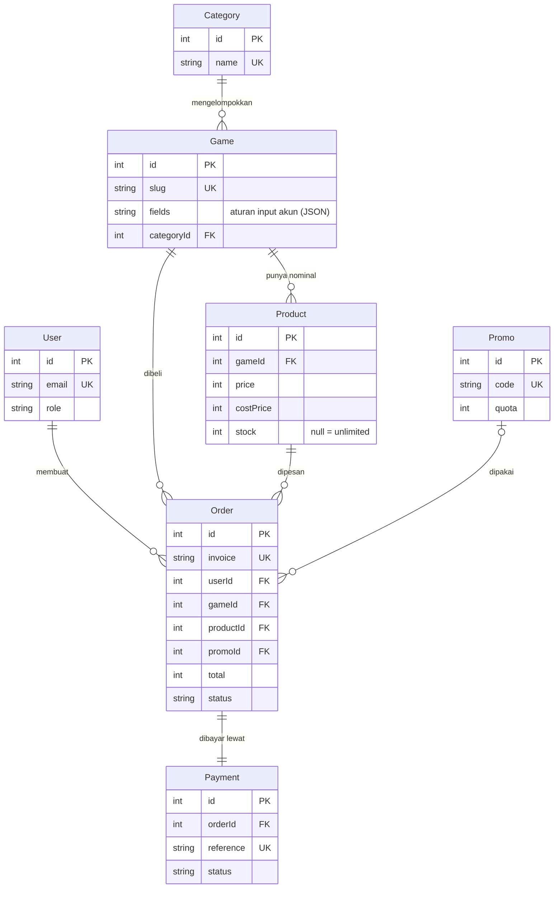

# ERD LapakLaut

Diagram interaktif: paste `docs/erd.dbml` ke [dbdiagram.io](https://dbdiagram.io).

## Penjelasan relasi

| Relasi | Jenis | Penjelasan |
|---|---|---|
| Category → Game | 1 : N | Satu kategori (MOBA, FPS, ...) berisi banyak game. |
| Game → Product | 1 : N | Satu game punya banyak nominal (86 Diamond, 172 Diamond, ...). Hapus game menghapus nominalnya (cascade). |
| User → Order | 1 : N | Satu user bisa punya banyak pesanan. |
| Game, Product → Order | 1 : N | Pesanan menunjuk game dan nominal yang dibeli. |
| Promo → Order | 1 : N (opsional) | Pesanan boleh memakai satu promo. `promoId` boleh kosong. |
| Order → Payment | 1 : 1 | Setiap pesanan punya tepat satu data pembayaran (`orderId` unik). |

## Keputusan desain
- **Snapshot di `Order`:** `itemLabel`, `price`, `costPrice`, `fee`, `discount` disalin saat checkout, jadi perubahan harga di katalog tidak mengubah laporan lama.
- **Soft delete:** game, produk, dan promo cukup dinonaktifkan (`active = false`) agar riwayat transaksi tidak rusak.
- **`Game.fields`:** aturan validasi ID akun (regex per field) disimpan di database, jadi game baru bisa ditambah tanpa mengubah kode.
- **`Product.stock` dan `Promo.quota`:** `null` berarti tanpa batas. Jika angka, dikurangi atomik di DB transaction dan dikembalikan saat pesanan gagal atau kedaluwarsa.
